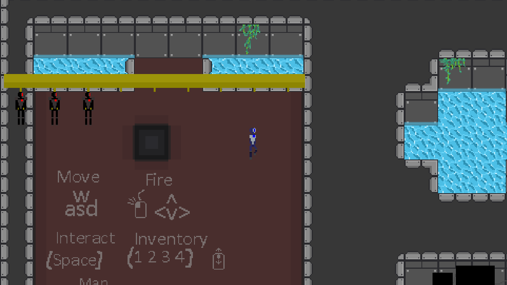

# cycle-of-steel

Cycle of Steel, a top-down roguelike shooter, being ported from its Unity project
onto [`crystal-engine`](../../crates/crystal-engine). The Unity project stays the
reference for behaviour while the port catches up.

## State of the port

Steps 1 to 3 of the port are in (foundation, real rooms, combat):

- **Foundation.** A fixed 60 Hz simulation, the player walking with their run
  animations, collision, a camera that follows inside the room, keyboard, mouse
  and gamepad input, and an Android build with on-screen sticks.
- **Real rooms.** All 34 rooms of the Unity project, converted by
  [`cos-convert`](../cos-convert) into `assets/rooms`, load and draw: tile layers,
  decorations, walls and ledges. The game starts in the hub.
- **Guns.** The guns lying in the hub can be picked up into a four-slot inventory
  and fired. Single-shot and spray guns work with Unity's numbers, including the
  heat mechanic, spread, bullets carrying the player's speed, splashes where they
  hit, and camera shake. Bullets stop at walls, fly over ledges and hurt targets.
  Lasers (`laser_2` and `debug_laser` in the gun room) shine a beam up to 20 units
  long that stops at the first wall or target and passes over ledges; it hurts
  every `damage_delay` and heats the gun each time it does, even against a wall,
  as in Unity.
- **Explosions and homing.** The bazooka's missile (`bazooka_1`) does nothing by
  itself; where it stops it leaves `Explosion 1`, which takes 200 from every
  target within 0.44 units, through walls, as in Unity. Homing bullets (`rifle_3`,
  `lmg_red`) are steered at the target nearest the *player*, as Unity chooses it,
  with Unity's force and drag: they slow to about 3 units per second and curve
  in, and with nothing to chase they simply slow down. Not yet, because nothing
  can be pushed or hurt back: the blast's knockback, its damage to the player,
  and hurting enemies that walk into it during its 0.3 seconds.

The hub's hidden gun room is reachable: stand at the right-hand end of the rack
where you spawn and interact. Interact again on the spot inside to leave.

- **Freezing.** `pistol_2`, `smg_1` and `minigun_1` fire Unity's one freezing
  bullet. What it hits is frozen only if its Unity object had an
  `ElementalEffectHandler`, which means enemies; the hub's dummy has none, so
  until enemies arrive nothing in the game shows it. The state is in
  `sim/elemental.rs`: freezes of 5 stack to a cap of 20, wear off in under a
  second, and are what will slow a frozen enemy (added drag) and tint it.
  Burning is deliberately not ported: no bullet in the Unity project burns, and
  Unity's burn code never deals its damage (the module's comment and a test show
  why).

- **Damage numbers.** Whatever is hurt floats the amount up from itself for 1.4
  seconds, placed up to 0.2 units off so that several can be told apart: red for
  an ordinary hit, larger and orange for a crit or an explosion, with sizes,
  colours and placement from Unity's two prefabs. They are written in the game's
  pixel font, Thaleah Fat, which `View::draw_text` can now draw anywhere in the
  world. Two differences from Unity: the glyphs come from the project's 16-pixel
  bitmap atlas rather than its TextMeshPro distance field, so they stay hard-edged
  at any size, and a number fades over its last 0.2 seconds instead of vanishing.

- **Tints as Unity shows them.** A colour set on a Unity `SpriteRenderer` is the
  colour picked on screen (sRGB). The project is in linear colour space, where
  Unity converts that colour to linear before its sprite shader (URP's
  `Sprite-Lit-Default`) multiplies the texture by it; this renderer's tints are
  linear too, so `view.rs` now makes the same conversion (`srgb_to_linear`) for
  decoration, bullet and splash tints, as it already did for damage numbers.
  Before, tints came out too bright and washed out: `pistol_2`'s bullet, authored
  as teal (32, 102, 125), drew as light blue (100, 170, 186). Every tinted bullet
  and its splash is darker and more saturated now. Rooms look the same: no
  decoration in the 34 converted rooms has a tint other than white (one in the
  hub is only made translucent, and alpha is not converted). Not compared against
  a running Unity build, and Unity's 2D lights, which the port lacks, also change
  what a bullet looks like there.

- **Chests and drops.** The dungeon rooms' four kinds of chest stand where Unity
  placed them, block the player, and take bullets, beams and blasts: 500 health,
  the damaged picture below 70%, and when they break, their remains on the floor
  and their loot. Loot is rolled as Unity's `Killable.Die` and `Spawner` roll it:
  a weapon chest leaves exactly one gun from its pool (earlier lines are likelier
  than their weights, as in Unity), a data chest a handful of data cells and
  health packs. Drops (also lying in the hub's gun room) fly to the player once
  within 1.5 to 2 units, through walls as in Unity, and are collected on touch:
  data cells add to the count under the health bar, a health pack gives back 100
  of the player's 1000. Unity pushes drops with a force every rendered frame, so
  its pull depends on the frame rate; it is taken at 60 frames a second. Not yet:
  the chests' and drops' glow (lighting, step 6), the chests' health bars (UI
  pass), and the pickup sounds (step 6). Nothing hurts the player yet, so the
  health bar only shows health packs at work once enemies arrive.

Not in yet:
enemies; lighting (rooms look flatter and brighter than in
Unity); audio; the dungeon; menus. The HUD is a plain placeholder.



## Run

```powershell
cargo run -p cycle-of-steel                 # the game
cargo run -p cycle-of-steel -- --help       # every option
cargo test -p cycle-of-steel                # simulation and input tests, no GPU needed
```

| | Keyboard and mouse | Gamepad | Touch |
| --- | --- | --- | --- |
| Move | W A S D | left stick or d-pad | drag on the left half |
| Shoot | arrows, or hold the mouse button | right stick | drag on the right half |
| Pick up | Space | A or X | the round button that appears |
| Choose a slot | 1 to 4, Q and E, or the wheel | shoulder buttons | tap the slot |

F11 toggles fullscreen and Escape quits.

`--screenshot` runs the game with no window, steps the simulation, draws one frame
off-screen and saves it. It needs a GPU or a software rasteriser but no display:

```powershell
cargo run -p cycle-of-steel -- --screenshot room.png --ticks 120 --move 1,0
cargo run -p cycle-of-steel -- --screenshot ns1.png --room ns1 --whole-room
cargo run -p cycle-of-steel -- --screenshot fire.png --give shotgun_1 --aim 1,0 --ticks 8
cargo run -p cycle-of-steel -- --screenshot beam.png --give laser_2 --aim -1,0.6 --ticks 8
cargo run -p cycle-of-steel -- --screenshot chests.png --room n1 --whole-room
```

`--room` picks any file under `assets/rooms`; `--whole-room` frames all of it, for
checking a room against its Unity original.

On Linux, building needs libudev's headers for gamepad support
(`apt-get install libudev-dev`).

## Android

The same game builds as an APK for 64-bit ARM phones, Android 8.0 and up. It runs
in landscape and is played with an on-screen stick: touch the left half of the
screen and drag to move, drag on the right half to aim and shoot.

**Getting a build onto a phone.** Every push that touches the game runs the
`Android APK` workflow, which replaces the `android-latest` pre-release on GitHub.
On the phone, open the repository's Releases page, download `cycle-of-steel.apk`
from "Android test build" and open it. Android asks once to let the browser install
apps. Later builds install over earlier ones.

**Building it yourself** needs the Android SDK and NDK and `cargo-apk`:

```sh
rustup target add aarch64-linux-android
cargo install cargo-apk --version 0.10.0 --locked
sdkmanager "platforms;android-33" "build-tools;34.0.0" "ndk;25.2.9519653"
export ANDROID_NDK_ROOT=$ANDROID_HOME/ndk/25.2.9519653
cargo apk build -p cycle-of-steel --lib --release     # target/release/apk/cycle-of-steel.apk
cargo apk run -p cycle-of-steel --lib --release       # build, install over USB, start
adb logcat -s cycle-of-steel                          # the game's log
```

The NDK is pinned to r25c because that is what `cargo-apk` 0.10 supports; its
highest platform is 33, hence `target_sdk_version = 33`.

How Android differs from desktop, and where that lives:

- **Entry point.** There is no `main`: the system loads the library and calls
  `android_main` (`src/lib.rs`). The APK holds no Java code (`NativeActivity`).
- **Surface.** Android takes the drawing surface away whenever the app leaves the
  screen. `app.rs` drops everything built on it in `suspended` and rebuilds it in
  `resumed`; the world is untouched, so the game is where you left it.
- **Assets.** They are entries inside the APK, read through `AssetSource::Apk`
  (`src/assets.rs`). Nothing else in the game knows where bytes come from.
- **Input.** Touch events drive `input::TouchControls`: two floating sticks and
  taps on the HUD. Controllers are not wired up
  on Android yet: the desktop gamepad library has no Android backend.

**The signing key in `android/` is not a secret.** It is committed, with its
password in `Cargo.toml`, so that builds from any machine can install over each
other. It must never sign a store release; that needs a private key kept out of
the repository.

## How it is put together

```text
src/
  main.rs        command line
  app.rs         window, fixed-timestep frame loop, screenshot mode
  input.rs       keys, mouse, gamepads and touch sticks -> sim::Input
  hud.rs         where the on-screen slots, heat bar and buttons sit
  view.rs        world state -> sprites; the camera
  assets.rs      loads assets from a folder, or from inside the APK on Android
  data.rs        the room and sprite catalogue file formats
  sim/           the game itself: no window, GPU or clock
    mod.rs       World, Input, the 60 Hz step, the inventory
    defs.rs      guns, bullets and effects as loaded data
    guns.rs      one gun's fire timer and heat
    combat.rs    bullets, hit effects, targets and chests, guns on the floor
    loot.rs      rolling a broken chest's loot; drops flying to the player
    elemental.rs being frozen (Unity's ElementalEffectHandler)
    rng.rs       the simulation's own random numbers
    room.rs      a room's grid of free, ledge and wall cells
    collide.rs   moving a box through solid cells
    player.rs    movement, facing, animation
assets/
  rooms/         one JSON file per room (format: see apps/cos-convert/README.md)
  guns.json      every gun, bullet and hit effect, with their numbers
  loot.json      chests, the loot pools they roll on, and drops
  sprites.json   every sprite by name: texture, rectangle, pivot
  font.json      the pixel font: each character's glyph sprite and advance
  sprites/       PNGs copied from the Unity project
android/
  test-signing.keystore   signs test APKs; not a secret, see "Android"
```

`sim` advances only through `World::step`, 60 times a second, whatever the frame
rate. The frame loop feeds real time into an accumulator, steps while it holds a
whole step, and passes the leftover fraction to the view, which blends between the
last two steps. Because `sim` touches no window, GPU or clock, tests step it
directly and the same inputs always give the same world.

## Matching Unity

Constants that reproduce the Unity project say where they come from. The player's
movement, for example, is derived from the old force, mass and drag values and
tested against them (`sim/player.rs`): top speed about 1.82 units per second.

Units are Unity's: sprites at 64 pixels per unit, tiles half a unit, rooms 16 by 9.

## Licence

The code is MIT or Apache-2.0 like the rest of the repository. The files under
`assets/` are not: see [`assets/LICENSE.md`](assets/LICENSE.md).
