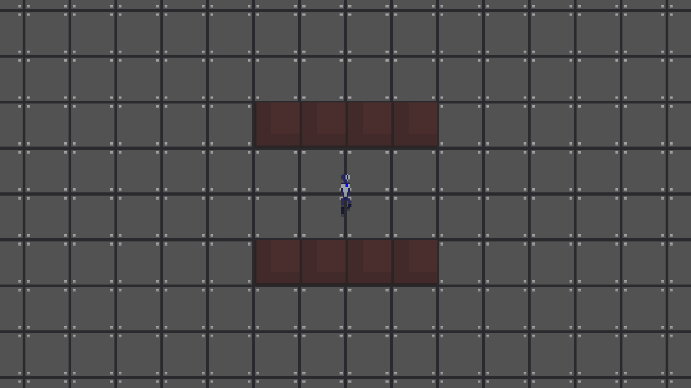

# cycle-of-steel

Cycle of Steel, a top-down roguelike shooter, being ported from its Unity project
onto [`crystal-engine`](../../crates/crystal-engine). The Unity project stays the
reference for behaviour while the port catches up.

## State of the port

Step 1 of the port, the 2D foundation, is in: a room drawn from tiles, the player
walking in it with their run animations, collision against walls, a camera that
follows inside the room, and keyboard and gamepad input.

The room is a stand-in built in code (`sim::room::Room::test_room`) from the real
tileset. Real rooms, guns, enemies, the dungeon, lighting, audio and menus come in
later steps.



## Run

```powershell
cargo run -p cycle-of-steel                 # the game
cargo run -p cycle-of-steel -- --help       # every option
cargo test -p cycle-of-steel                # simulation and input tests, no GPU needed
```

Keys: WASD or the arrows to move (or a gamepad's left stick or d-pad), F11 for
fullscreen, Escape to quit.

`--screenshot` runs the game with no window, steps the simulation, draws one frame
off-screen and saves it. It needs a GPU or a software rasteriser but no display:

```powershell
cargo run -p cycle-of-steel -- --screenshot room.png --ticks 120 --move 1,0
```

On Linux, building needs libudev's headers for gamepad support
(`apt-get install libudev-dev`).

## How it is put together

```text
src/
  main.rs        command line
  app.rs         window, fixed-timestep frame loop, screenshot mode
  input.rs       keys and gamepads -> actions -> sim::Input
  view.rs        world state -> sprites; the camera
  assets.rs      finds and loads files under assets/
  sim/           the game itself: no window, GPU or clock
    mod.rs       World, Input, the 60 Hz step
    room.rs      tile layers and the solid grid
    collide.rs   moving a box through solid cells
    player.rs    movement, facing, animation
assets/
  sprites/       PNGs copied from the Unity project
```

`sim` advances only through `World::step`, 60 times a second, whatever the frame
rate. The frame loop feeds real time into an accumulator, steps while it holds a
whole step, and passes the leftover fraction to the view, which blends between the
last two steps. Because `sim` touches no window, GPU or clock, tests step it
directly and the same inputs always give the same world.

## Matching Unity

Constants that reproduce the Unity project say where they come from. The player's
movement, for example, is derived from the old force, mass and drag values and
tested against them (`sim/player.rs`): top speed about 1.82 units per second.

Units are Unity's: sprites at 64 pixels per unit, tiles half a unit, rooms 16 by 9.
