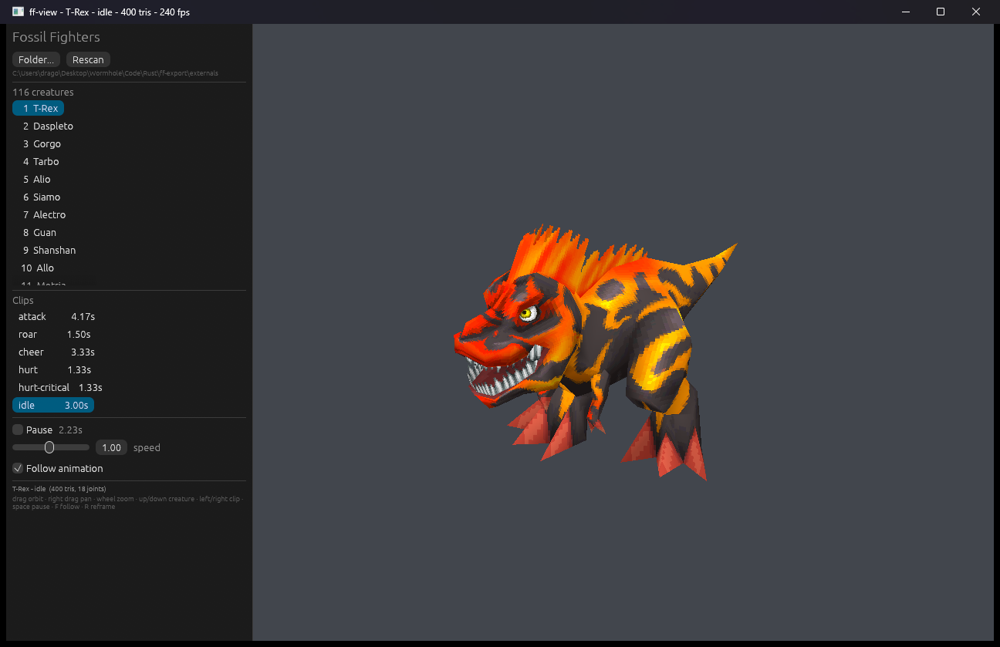

# ff-view

A low-poly model viewer: glTF/GLB in, wgpu out. Skinning and animation clips
work; the point is to look at exported Fossil Fighters creatures without
bouncing through Blender, and to grow into the renderer the engine will reuse.

Deliberately **not** Fossil-Fighters-specific. It consumes glTF, so anything
`ff-export` produces - or any other exporter - opens the same way. The coupling
between the two projects is a file format, which is why neither depends on the
other even though both now live in this repository.

The package builds two binaries on one library, and they are the same window:

| Binary | What it is |
| --- | --- |
| `ff-view` | one file full-window; with a folder - passed, remembered or dropped - the same window grows the creature/clip panel. `--info` / `--screenshot` live here |
| `ff-browser` | the same window with the panel always on, starting on the last folder |

## The picker



An export folder makes the window list its creatures and clips. A folder can
arrive three ways: as the path, as a drop on any `ff-view` window, or as the
remembered folder on the next launch.

```powershell
cargo run -p ff-view -- .\out\ff1_usa
cargo run -p ff-browser
```

Either way it reads `manifest.json`, lists the creatures, and renders the
selected clip with the same renderer - textures, skinning and animation included.

```text
left drag            orbit             ↑ ↓   previous / next creature
middle / right drag  pan               ← →   previous / next clip
wheel                zoom              space pause
```

Each entry in the manifest is a clip, not a creature, because every clip carries
its own mesh and bind pose; the window therefore loads one `.glb` per selection.

Creatures open on **idle** by default (`--clip` overrides that), and switching
creatures keeps the clip you were watching, matched by name: pick **idle** on one
creature and the next opens on its own idle, at whatever position that clip sits
in its list - or on its first clip if it has no idle at all. Pause and speed carry
over with it, and so do the camera angle and zoom: switching re-points the orbit
target at the new creature instead of reframing it. **↑/↓** repeat while held and
stop at the ends of the list rather than wrapping.

The camera frames the rest pose and then follows the animated centre, so a lunge
does not walk out of frame. **F**, or the *Follow animation* checkbox in the
panel, turns that follow off (it is on by default). Near and far planes track the
zoom level, so zooming a long way out never clips the model away.

A dropped folder only needs `manifest.json` with `creatures[].clips[].glb`; the
paths are resolved relative to the folder. Dropping a loose `.glb` also works and
shows that file alone. `ff-browser` opens on the last folder `ff-view` opened, or
on `apps\ff-export\externals` when run from the repository root.

### Why egui here and Slint in `ff-export`

The 3D scene is drawn straight to the swapchain inside the panel's rectangle and
egui draws over it in a second pass on the same encoder - one window, one device,
no read-back, and the panel is plain Rust in this crate.

Slint could host it too, but only through its wgpu interop: with the
`unstable-wgpu-30` feature, `BackendSelector::require_wgpu_30` shares the device
and queue with the app, and `slint::Image::try_from(wgpu::Texture)` imports a
texture the viewer rendered into, so the viewport could live in the UI without a
read-back. That path is feature-flagged as unstable and versioned per wgpu major,
and it would move the panel into `.slint` files plus a build step. For a panel
with one list that is not yet worth it - and Slint's licensing (GPLv3, a
royalty-free desktop licence, or commercial) is a different trade from egui's
MIT/Apache-2.0. `ff-export`'s window has no 3D in it, so it stays Slint.

## Starting it with no arguments

```powershell
cargo run -p ff-view
```

opens the picker window with nothing loaded: **Folder...**, or a drop of one
`.glb`/`.gltf` or a whole export folder. A folder is remembered the moment it is
opened, before any clip loads, so closing the window cannot lose it - the next
bare launch reopens it on its first creature and clip.

It is written to `%APPDATA%\ff-view\settings.json` (`$XDG_CONFIG_HOME/ff-view/settings.json`
elsewhere). If that location cannot be written - a locked-down profile, an
antivirus rule, or a terminal that confines writes to the repository - saving
falls back to local app data, then to `~/.ff-view\settings.json`, and finally to
`ff-view-settings.json` beside the executable (which is `target\debug` for
`cargo run`). The file actually used is printed on open. `FF_VIEW_CONFIG` pins
the location outright, which is the way to keep it somewhere specific, for
example inside the repository:

```powershell
$env:FF_VIEW_CONFIG = ".\ff-view-settings.json"
```

To see what a launch would reopen, and where it comes from:

```powershell
cargo run -p ff-view -- --settings
```

A folder passed as the path is the same thing without the dragging, and so is a
folder dropped on a window that is already showing a model - the panel appears
either way:

```powershell
cargo run -p ff-view -- .\out\ff1_usa
cargo run -p ff-view -- .\out\ff1_usa --info
```

Inside a folder, **up/down** walk creatures and **left/right** walk that
creature's clips, so the list is reachable without the mouse. A folder with no
`manifest.json` still works - each `.glb` in it becomes a one-clip entry - which
is the fastest way to look at a handful of files someone sent you.

## Usage

```powershell
cargo run -p ff-view -- ".\out\ff1_usa\glb\breme_030_attack.glb"

# what is in the file, without opening a window
cargo run -p ff-view -- path\to\model.glb --info

# pick a clip, start in wireframe
cargo run -p ff-view -- model.glb --clip roar --wireframe

# render five frames and exit: a smoke test for CI or a GPU-less shell
cargo run -p ff-view -- model.glb --frames 5

# one frame to a PNG, off-screen: for asset diffs, no window appears
cargo run -p ff-view -- model.glb --screenshot shot.png
```

```
--info                  print the scene's (or folder's) contents and exit
--settings              print where the last folder is remembered and exit
--clip <index|name>     start on a specific animation clip
--wireframe             start in wireframe mode (needs POLYGON_MODE_LINE)
--bind-pose             ignore animation clips and show the rest pose
--backend <name>        gl | vulkan | dx12 | metal | all (default: all)
--frames <n>            render n frames, then exit
--screenshot <file>     render one frame off-screen, save it, and exit
```

`--info` never touches wgpu, and `--screenshot` renders into an off-screen
texture, so both work on a machine with no visible desktop.

## Controls

| Input | Action |
| --- | --- |
| left drag | orbit |
| middle drag, right drag | pan |
| wheel | zoom |
| space | pause / resume the clip |
| n / p | next / previous clip in this file |
| up / down | previous / next creature (folder panel) |
| left / right | previous / next clip (folder panel) |
| w | toggle wireframe |
| f | toggle camera follow (on by default) |
| r | reset camera and clip |
| drop a file or folder | load it (a folder opens the panel and is remembered) |
| esc | quit |

The 3D area takes pointer input wherever the cursor happens to be over it - no
click to give it focus first - and the edge between it and the panel is a hard
boundary: the wheel over the panel scrolls the creature and clip lists instead of
zooming, and a drag that starts on a slider stays on the slider.

The camera frames the model's bind-pose bounds on load, so assets authored in
centimetres and assets authored in metres both fill the window. With a folder
open it also follows the animated centre so a lunge does not walk out of frame;
panning still works, because only the *change* in that follow offset is applied
each frame.

## How it is put together

```text
src/
  lib.rs         the library both binaries use
  main.rs        `ff-view`: the CLI, then `ui::run`
  bin/browser.rs `ff-browser`: the same window, panel always on
  ui.rs          the window: scene, folder panel, input, title
  math.rs        Vec3 / Quat / Mat4 / Aabb, column-major
  scene.rs       CPU scene: nodes, meshes, materials, textures, skins
  loader.rs      glTF 2.0 -> scene (the only file that knows about `gltf`)
  library.rs     an export folder: manifest.json, or a scan for .glb files
  settings.rs    the last folder, remembered between launches
  anim.rs        keyframe sampling and clip playback
  camera.rs      orbit camera, fitted from bounds
  renderer.rs    wgpu: pipelines, buffers, bind groups, draw loop
  shaders/
    model.wgsl   skinned vertex stage, two-light fragment stage
```

The dependency direction is one-way: `loader` -> `scene` -> `renderer`. Nothing
below `ui` knows about a window, and nothing above `renderer` knows about wgpu,
which is what makes `--info` and the unit tests possible without a GPU. Both
binaries are thin: they decide what to open and hand it to `ui::run`.

`Renderer` exposes the frame in three calls - `begin_frame`, `encode_scene`
(which takes the viewport rectangle and the camera), `end_frame` - so a caller
that wants to draw something else on top can insert a pass between them. That is
all the window needs to put egui over the 3D, and to shrink the 3D to the area the
panel leaves free.

### Skinning

Joint matrices are computed on the CPU once per frame
(`inverse(mesh_node_world) * joint_world * inverse_bind`, per the glTF spec) and
uploaded as a uniform array of 128 `mat4`s; the vertex shader does the four-way
weighted sum. That is the wrong call for thousands of characters, and the right
call for one model at a time: the sampling code stays unit-testable and the
shader stays short. When this becomes an engine renderer, joint matrices move to
a storage buffer and the CPU pass becomes an optional fallback.

The formula collapses to identity at the rest pose, which is the cheapest way to
tell whether a rig is being read correctly. Point it at a real file to check:

```powershell
$env:FF_VIEW_TEST_MODEL = "path\to\rigged.glb"
cargo test -p ff-view bind_pose -- --ignored --nocapture
```

### Flat rigs

Some exporters - Blender's glTF exporter among them - emit a skin's joints as
nodes that appear in no scene graph at all, referenced only from `skin.joints`.
Those nodes are treated as roots, because the alternative is leaving them at the
identity and having every skinned mesh collapse to a point. One of the assets
used to test this viewer had 62 of its 71 joints in exactly that state.
`scene::tests::orphaned_nodes_act_as_roots` covers it.

## Current limits

- **No mipmaps.** Textures upload at full size and alias at distance. This is
  the first thing that will look wrong on a big sheet.
- **Alpha is cut-out only.** `alphaMode: MASK` discards, everything else is
  opaque; there is no blending pipeline yet.
- **Cubic-spline clips are approximated.** Tangents are dropped and the key
  values are interpolated linearly. Fossil Fighters exports are linear anyway.
- **Morph targets are skipped.** The Fossil Fighters pipeline does not produce
  them.
- **glTF only.** No OBJ, no FBX, no `ff-export`'s own formats. Adding a second
  producer means writing another `-> Scene` function, not touching the renderer.

## Workspace

This crate is a member of the `rust-dev` workspace at the repository root,
alongside `ff-export` and `crystal-engine`; see the root README. Shared code (a common
format library, for example) goes in `crates/` when there is something to share.
